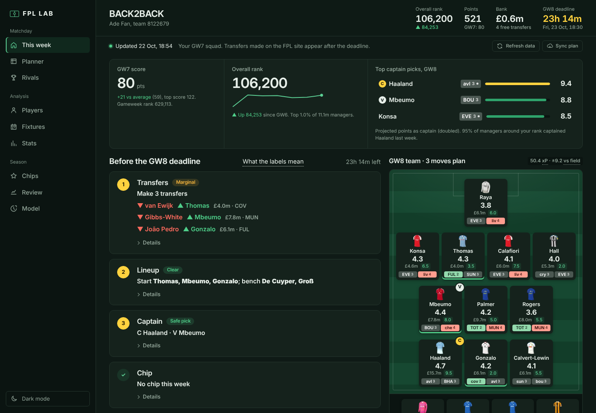
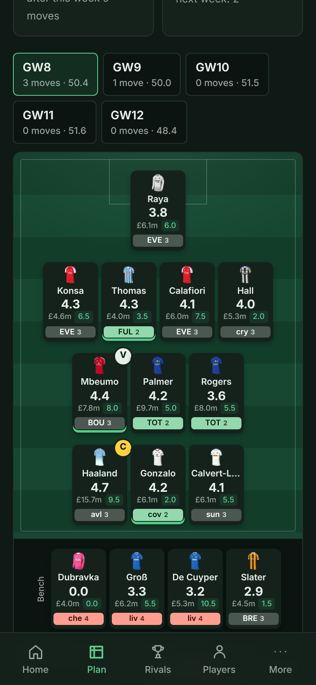
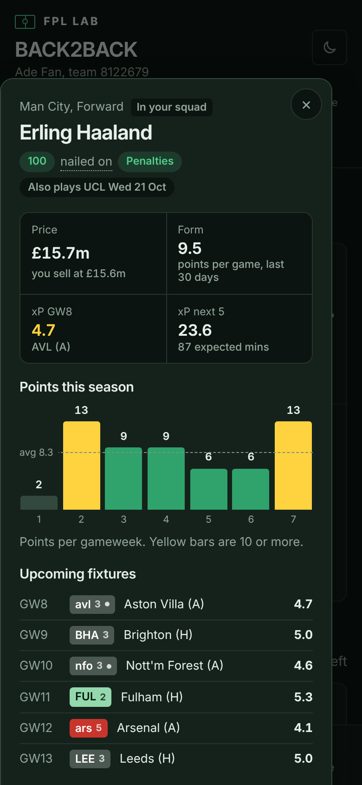

# FPL LAB

A personal Fantasy Premier League assistant at **https://afg-design.github.io/FPL-Lab/**.



| Pitch view (phone) | Player detail (phone) |
| --- | --- |
|  |  |

More: [light mode](docs/screenshots/dashboard-desktop-light.png), [player explorer](docs/screenshots/players-desktop.png), [fixtures](docs/screenshots/fixtures-desktop.png).

- **This week:** a deadline checklist covering transfers, lineup, captain, chip and risks, each with a plain verdict (Strong, Marginal, Coin flip) and details on tap. A strategy switch picks Balanced, Play safe (track the managers around your rank) or Chase rank (differentials).
- **Planner:** tap a player to make him captain or vice, bench or start him, lock him or replace him. **Re-plan** runs the optimiser in your browser (HiGHS, in `site/vendor/`) with your locks, bans, captains and hit limit.
- **Planner extras:** plan length (3, 5 or 6 GWs), pair suggestions where one sale funds a bigger upgrade, and up to 3 saved drafts compared side by side.
- **Planner (moves):** tap players to plan transfers over 5 gameweeks, with budget, club limits, free transfers and hits worked out live. Load the optimiser's plans as a starting point.
- **AFG suggestion:** its own tab. A fan's-eye punt layer on top of the model: record against the opponent and at the ground, home and away form, head-to-heads, hot runs, Europe and new managers. Gives its own captain, lineup and punt transfers, and a scoreboard that marks AFG against the model every gameweek. The rest of the app still follows the model.
- **Rivals:** what the top 10k and managers around your rank own and captain, the biggest threats and your differentials, and your mini-leagues with a rival-by-rival comparison.
- **Fixtures, Players, Stats, Chips, Season:** a fixture ticker, a player explorer with price-change progress, underlying form (xGI/90), over- and under-performers, team xG trends, player charts, chip planning and rank history.
- **Review:** each gameweek's captain, bench, transfers and model check, plus season totals and your best and worst transfers.
- **Install and sync:** add it to your home screen; plans sync between devices through a `sync` branch (needs a fine-grained token with Contents read/write on this repo).
- **Model:** how accurate the projections have been this season, plus how they work.

## How it works

| File | What it does |
| --- | --- |
| `fplmodel.py` | Projection model: team ratings from xG, minutes, per-90 rates blended with last season, FPL scoring, calibration |
| `optimise.py` | Multi-gameweek transfer optimiser (integer programme, CBC via PuLP) |
| `backtest.py` / `tune.py` | Re-projects past gameweeks to measure and tune the model |
| `bench.py` | Test bench for model changes: re-projects every gameweek of this season and of 2025/26, and scores accuracy plus the picks and captains the app would make. `python3 bench.py '{"recency":0.85}'` compares a parameter set with the current model |
| `archive.py` | Rebuilds a past season (default 2025/26) in the live API's shape from the public vaastav/Fantasy-Premier-League archive, for `bench.py`. Cached in `archive/` (not committed) |
| `crowd.py` | Samples 2,000 top-10k teams, 500 around your rank and your mini-league rivals once per gameweek into `crowd/latest.json` |
| `europe.json` | European fixtures used to flag rotation risk. Edit if dates change |
| `understat.py` | Shots, shots in the box, big chances (xG ≥ 0.3) and chances created from Understat, cached per match in `understat/` (workflow every 3 hours) |
| `site/plan-solver.js` | The browser version of the optimiser |
| `odds.py` | Betting-market expected goals per match from football-data.co.uk (match result and over/under odds), blended into team ratings and fixture projections |
| `odds_players.py` | Player odds (anytime goalscorer, 1+ assist) from The Odds API at 72 h, 24 h and 3 h before each deadline, into `odds/players.json` and `history/player_odds_gw*.json`. Saves derived chances only. Collected for testing; not yet used by the model |
| `history/` | Projections saved before each deadline, used for the live accuracy log on the Model page. `status.json` logs every flagged player's injury/suspension status before each deadline, so the model can tell an injured player from a dropped one. `transfers_gw*.json` samples transfers in/out, ownership and injury flags for the next deadline (every 6 h, hourly inside 48 h, every 25 min inside 3 h) to test whether late selling predicts a benching; format in `transfer_log.py` |
| `afg.py` | The AFG suggestion: venue, opponent and home/away records since 2019/20 (summarised weekly into `afg/records.json`), the nudges on top of the model, the week's picks and the scoreboard (`history/afg_gw*.json`). `python3 afg.py backtest` re-runs it on 2025/26. Hand-edited inputs (new managers, extra derbies) go in `afg_manual.json` |
| `make_priors.py` | Downloads every player's previous seasons into `priors.json` (weekly workflow) |
| `build.py` | Fetches the FPL API, runs everything and writes `site/data.json` |
| `site/` | The web app (see **Front end** below) |

`.github/workflows/refresh.yml` rebuilds and publishes every 30 minutes. `priors.yml` refreshes `priors.json` every Monday. `crowd.yml` checks every 20 minutes and samples other managers' teams once per gameweek, just after the deadline.

## Settings

- **Team ID:** repository variable `FPL_TEAM_ID` (Settings → Secrets and variables → Actions → Variables). Default 8122679.
- **Player odds:** repository secret `ODDS_API_KEY` (a free key from the-odds-api.com, 500 credits a month). About 20 credits per refresh, 3 refreshes per gameweek. Without the secret the step is skipped.
- **Refresh now:** Actions → "Refresh FPL data" → Run workflow, or the button on the dashboard.
- **Compare any team:** `watch.json` lists extra team IDs to fetch each refresh (`{"teams": [{"id": 123456, "label": "Friend"}]}`, up to 20). The overall leader is always included. The Rivals page adds and removes teams in one tap if Sync is set up; editing the file triggers a rebuild.
- **Live gameweeks:** a second schedule runs every 10 minutes but only rebuilds while a match is on (kick-off up to 2.5 hours ago), so Home's live panel stays current. GitHub can start scheduled runs a few minutes late.
- **Health check:** the site warns when data is over 2 hours old or the last refresh job failed (read from the public GitHub API). GitHub also emails you when a scheduled run fails (Settings → Notifications → Actions on github.com).

## Run locally

```
pip install -r requirements.txt
python3 build.py 8122679 site/data.json   # fetches the FPL API and writes the data file (about 20 s)
npm install                               # dev tools only: linting and checks
npm run dev                               # serves site/ at http://localhost:8000
```

`build.py` also updates files in `history/`; discard those changes (`git checkout -- history/`) unless you mean to commit them. The site needs no build step: GitHub Pages publishes `site/` exactly as it is.

Before changing the model, run `python3 bench.py` (needs `raw/` from a local build: `bootstrap.json`, `fixtures.json`, `live1.json`…) and keep a change only if it helps on both seasons.

Before committing front-end changes:

```
npm test        # ESLint + Stylelint, then the whole-app check below
npm run sw      # after adding or removing a script or stylesheet: refreshes the offline file list in sw.js
```

`npm run check` reads every script in page order to catch names that are used but never defined (or defined twice), confirms every file the page, manifest and service worker refer to exists, and that each one is cached for offline use.

## Front end

Plain HTML, CSS and JavaScript with no framework or bundler. The scripts are classic `<script defer>` files that share one global scope and load in the order listed in `index.html`; each view returns an HTML string and `render()` swaps it in.

```
site/
  index.html              app shell: sidebar, top bar, status line, bottom nav, dialog
  styles/
    tokens.css            colours (dark default + light), type, spacing, motion, Inter @font-face
    base.css              reset, typography, focus ring, reduced motion
    layout.css            sidebar (≥900px), top bar, status line, bottom nav and More sheet (phones)
    components.css        reusable pieces (below)
    views.css             screen-specific styles
  js/
    core/state.js         app state, constants, formatting helpers
    core/model.js         fixture lookups, projections, lineup and captain rules (same maths as the optimiser)
    core/plan.js          plans and the sandbox: the one plan every screen uses
    data/load.js          loads data.json, skeleton while loading, error state with retry, 5-minute refresh
    data/github.js        one-tap refresh and plan sync (token stays in this browser)
    components/ui.js      icon, FDRChip, StatBadge, skeleton, empty/error StateView
    components/pitch.js   PlayerCard and PitchView
    components/player-sheet.js  player detail (bottom sheet on phones)
    components/explain.js tap-to-explain terms
    shell/theme.js        dark/light toggle, saved per device
    shell/nav.js          header stats, sidebar/bottom nav, hash routing, render() with a per-view error boundary
    shell/events.js       event wiring after each render
    views/*.js            one file per screen: week, afg, planner, rivals, players, fixtures, stats, chips, review, model
  vendor/                 HiGHS solver and the self-hosted Inter font (with licences)
```

Data fetching (`data/`) is kept apart from presentation (`components/`, `views/`); `build.py` and the `data.json` format are unchanged.

**Components**

| Component | Function | Notes |
| --- | --- | --- |
| FDRChip | `fdrChip(fixture, { gw })` | FPL's official difficulty: 1–2 green, 3 grey, 4–5 red. The number is always printed, so colour is never the only signal. `fdrKey()` draws the legend. |
| StatBadge | `statBadge(label, value, { sub, tone })` | A labelled number with tabular figures. |
| PlayerCard | `card(id, gw, opts)` | Kit, name, projected points, price, form, next two fixtures, captain/vice badge, injury flag, full spoken label. |
| PitchView | `pitch(xi, bench, gw, opts)` | Formation rows on a stylised pitch, bench and key. |
| DataTable | `.tablebox` + `table` | Sticky header (and sticky first column in the player explorer); keyboard-scrollable. |
| Player detail | `openPlayer(id)` | Points history, upcoming fixtures, price change, key stats. |
| States | `skeleton()`, `stateView({ kind, title, body, action })` | Loading, empty and error. |

**Design tokens.** Change colours in `styles/tokens.css` only. `--accent` (pitch green) is for actions; `--hi` (armband yellow) is kept for captaincy, the deadline and the current selection. `--f1`…`--f5` are the difficulty colours. All text pairs meet WCAG AA in both themes.

### Screenshots

The images above live in `docs/screenshots/`. To retake them after a design change:

```
pip install playwright && python3 -m playwright install chromium
npm run dev                         # keep this running
python3 scripts/screenshots.py      # writes docs/screenshots/*.png
```

The script avoids the mini-league screen so other managers' names aren't published in the repository.

## Reliable automatic updates (backup scheduler)

GitHub's built-in schedule can start late or not at all. A free external scheduler keeps the data fresh:

1. Create a fine-grained GitHub token: Settings → Developer settings → Fine-grained tokens → **Only select repositories: FPL-Lab** → Permissions: **Actions: Read and write**. Copy it.
2. Sign up at [cron-job.org](https://cron-job.org) (free) and create a cron job:
   - **URL:** `https://api.github.com/repos/AFG-design/FPL-Lab/actions/workflows/refresh.yml/dispatches`
   - **Schedule:** every 10 minutes
   - **Advanced → Request method:** `POST`
   - **Headers:** `Authorization: Bearer YOUR_TOKEN`, `Accept: application/vnd.github+json`, `X-GitHub-Api-Version: 2022-11-28`, `Content-Type: application/json`
   - **Request body:** `{"ref":"main","inputs":{"live_only":"true"}}`
3. Save. Each call starts the refresh workflow; with `live_only` it rebuilds every 10 minutes while a match is on and otherwise about every half hour (other calls finish in seconds). GitHub replies 204 (no content) when it works.

The dashboard's **Refresh data now** button does the same on demand when the token saved under **Sync plan** has Actions access.
