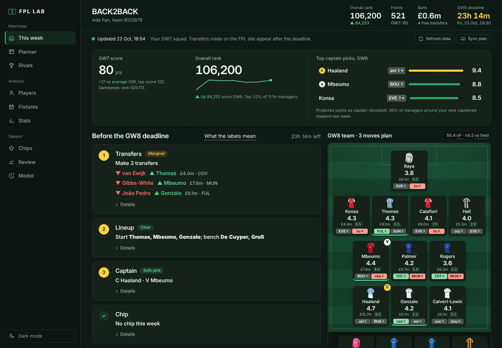
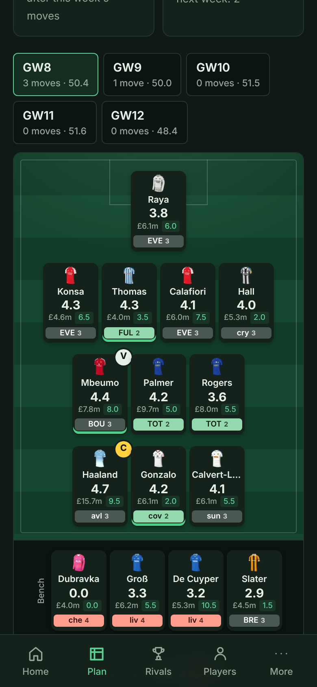
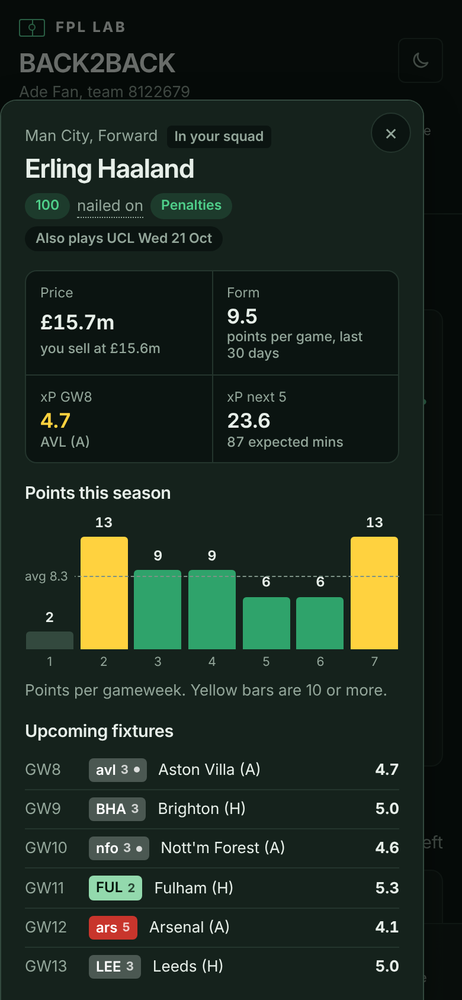

# FPL LAB

A personal Fantasy Premier League assistant at **https://afg-design.github.io/FPL-Lab/**.



| Pitch view (phone) | Player detail (phone) |
| --- | --- |
|  |  |

More: [light mode](docs/screenshots/dashboard-desktop-light.png), [player explorer](docs/screenshots/players-desktop.png), [fixtures](docs/screenshots/fixtures-desktop.png).

- **This week:** two views behind one switch. **Next deadline** is for preparing: your plan (labelled as the model's recommendation or your own draft), three calls for transfers, captain and lineup with a plain verdict (Strong, Marginal, Coin flip), the pitch, quick research shortcuts, your watchlist and anything that needs attention. **Current GW** shows the squad you actually submitted with its live or final points, match states (to play, playing, finished, did not play, double gameweeks), the live rank estimate, rival differences and the pre-deadline forecast. Both show team value, bank and expected points above the pitch. The view you pick is remembered; on a first visit it opens on Current GW only while FPL says a gameweek is under way.
- **Planner:** tap a player to make him captain or vice, bench or start him, lock him or replace him. **Re-plan** runs the optimiser in your browser (HiGHS, in `site/vendor/`) with your locks, bans, captains and hit limit.
- **Planner extras:** plan length (3, 5 or 6 GWs), pair suggestions where one sale funds a bigger upgrade, and up to 3 saved drafts compared side by side.
- **Planner (moves):** tap players to plan transfers over 5 gameweeks, with budget, club limits, free transfers and hits worked out live. Load the optimiser's plans as a starting point.
- **AFG suggestion:** its own tab. A fan's-eye punt layer on top of the model: record against the opponent and at the ground, home and away form, head-to-heads, hot runs, Europe and new managers. Gives its own captain, lineup and punt transfers, and a scoreboard that marks AFG against the model every gameweek. The rest of the app still follows the model.
- **Rivals:** what the top 10k and managers around your rank own and captain, the biggest threats and your differentials, and your mini-leagues with a rival-by-rival comparison.
- **Deadlines:** the countdown to the next deadline, price changes and kick-offs. The deadline in the header opens it.
- **You vs the model:** each finished gameweek, your actual points after hits against the model's target, with both teams on pitches side by side. The **decision journal** is on the same tab: your moves and captain next to the model's suggestion for that week, saved before the deadline, with your Why? and Why not? reasons.
- **Data health:** when each source last updated, the recent refresh runs and anything that failed. The "Updated" time in the status line opens it.
- **xP table:** a tab next to Players and Stats: every player's projected points per gameweek with the fixture, shaded by value, plus Σ or average over 3, 5 or 6 GWs, xP per £m and, during a live gameweek, what was projected before its deadline next to live points.
- **Fixtures, Players, Stats, Chips, Season:** a fixture ticker, a player explorer with price-change progress, underlying form (xGI/90), over- and under-performers, team xG trends, player charts, chip planning and rank history.
- **Review:** each gameweek's captain, bench, transfers and model check, plus season totals and your best and worst transfers.
- **Install and sync:** add it to your home screen; plans sync between devices through a `sync` branch (needs a fine-grained token with Contents read/write on this repo).
- **Model:** how accurate the projections have been this season, plus how they work.

## How it works

| File | What it does |
| --- | --- |
| `fplmodel.py` | Projection model: team ratings from xG, minutes, per-90 rates blended with last season, FPL scoring, calibration |
| `optimise.py` | Multi-gameweek transfer optimiser (integer programme, CBC via PuLP) |
| `backtest.py` / `tune.py` | Re-projects past gameweeks to measure and tune the model. `backtest.py` also prints a segment breakdown; `--status-log`, `--json` and `--compare` are for before/after checks (see `CLAUDE.md`) |
| `strategy_replay.py` | Replays Balanced, Play safe and Chase rank over past seasons (default 2025/26 and 2024/25, from GW5) with the same planning code the site uses, to check each behaves as its name says: real points, hits and how bumpy the ride was against the field |
| `bench.py` | Test bench for model changes: re-projects every gameweek of this season and of 2025/26, and scores accuracy plus the picks and captains the app would make. `python3 bench.py '{"recency":0.85}'` compares a parameter set with the current model |
| `archive.py` | Rebuilds a past season (default 2025/26) in the live API's shape from the public vaastav/Fantasy-Premier-League archive, for `bench.py`. Cached in `archive/` (not committed) |
| `crowd.py` | Samples 2,000 top-10k teams, 500 around your rank and your mini-league rivals once per gameweek into `crowd/latest.json` |
| `europe.json` | European fixtures used to flag rotation risk. Edit if dates change |
| `understat.py` | Shots, shots in the box, big chances (xG ≥ 0.3) and chances created from Understat, cached per match in `understat/`. Runs inside the refresh job; `understat.yml` is a manual run only |
| `xmins.py` + `xmins/` | The minutes model, on by default: four pre-trained XGBoost models (start chance, minutes if he starts, bench-appearance chance, minutes from the bench) stored as plain JSON in `xmins/`. Its inputs are rebuilt from FPL data before each gameweek; missing history is left as missing, not filled in. See `docs/xmins-eval.md` |
| `site/plan-solver.js` | The browser version of the optimiser |
| `odds.py` | Betting-market expected goals per match from football-data.co.uk (match result and over/under odds), blended into team ratings and fixture projections |
| `odds_archive.py` | The same odds for past seasons (default 2024/25 and 2025/26) into `odds/archive/`, so `bench.py` tests the archive seasons with odds as the live model runs. Fails without writing if the join is incomplete. Re-run from Actions → "Backfill archive odds" |
| `odds_players.py` | Player odds (anytime goalscorer, 1+ assist) from The Odds API at 72 h, 24 h and 3 h before each deadline, into `odds/players.json` and `history/player_odds_gw*.json`. Saves derived chances only. Collected for testing; not yet used by the model |
| `history/` | Projections saved before each deadline, used for the live accuracy log on the Model page. `status.json` logs every flagged player's injury/suspension status before each deadline, so the model can tell an injured player from a dropped one. `transfers_gw*.json` samples transfers in/out, ownership and injury flags for the next deadline (every 6 h, hourly inside 48 h, every 25 min inside 3 h) to test whether late selling predicts a benching; format in `transfer_log.py` |
| `transfer_log.py` | Writes the pre-deadline transfer log (`history/transfers_gw*.json`) and documents its format |
| `deadline_snapshot.py` | Writes `history/deadline_gw*.json`, what the app knew before each deadline: every player's xP for each plan gameweek, start chance and minutes, simulated outcomes, the odds as they stood and each strategy's plan. Anything it could not save is listed under `missing` |
| `squad_state.py` | Works out which squad and bank the plans start from. After a Free Hit, that is the squad FPL restores, not the temporary one |
| `fpl_score.py` | Scores a gameweek team the way FPL does (automatic substitutions, captain and vice, Bench Boost and Triple Captain). Used for You vs the model |
| `decision_journal.py` | Builds the decision journal: one entry per gameweek with a deadline snapshot (GW10 on), what you did next to what the model suggested, from files saved before the deadline |
| `afg.py` | The AFG suggestion: venue, opponent and home/away records since 2019/20 (summarised weekly into `afg/records.json`), the nudges on top of the model, the week's picks and the scoreboard (`history/afg_gw*.json`). `python3 afg.py backtest` re-runs it on 2025/26. Hand-edited inputs (new managers, extra derbies) go in `afg_manual.json` |
| `make_priors.py` | Downloads every player's previous seasons into `priors.json` (weekly workflow) |
| `build.py` | Fetches the FPL API, runs everything and writes `site/data.json` |
| `validate.py` | Checks a freshly built `data.json` before it is published. Errors stop the refresh, so the last good site stays live; warnings are saved for the Data health page |
| `scripts/refresh.py` | What the refresh job runs: `crowd.py`, `understat.py`, `odds.py` and `odds_players.py` (if one fails, the job warns and the build uses the last committed data), then `build.py` and `validate.py`, then commits the data and pushes it to `main`, with up to three attempts if `main` moved meanwhile |
| `scripts/push_data.py` | Used by the priors and archive-odds workflows to push their data commit: rebases on the latest `main` and retries, never force-pushes, and fails visibly if the edits overlap |
| `site/` | The web app (see **Front end** below) |

Workflows in `.github/workflows/`:

- `refresh.yml` runs `scripts/refresh.py`, then publishes `site/` to GitHub Pages. It is scheduled twice an hour (at 7 and 37 minutes past), and also runs on every push to `main`, from the Run workflow button and from the dashboard's Refresh button. A second schedule every 10 minutes only rebuilds while a match is on.
- `check.yml` (Check site) runs on every pull request: see **Run locally** below.
- `priors.yml` refreshes `priors.json` and the AFG records (`afg/records.json`) every Monday at 04:17 UTC.
- `crowd.yml` and `understat.yml` are manual runs only. The refresh job already runs `crowd.py` and `understat.py` each time.
- `odds-archive.yml` (Backfill archive odds) is a manual run only: it rebuilds `odds/archive/` with `odds_archive.py`.

The schedule is what is asked for, not what happens. GitHub starts scheduled runs when it has room, and they can be hours late: on 10 Nov 2026 the data commits on `main` were about eight hours apart for most of the day (03:26, 11:42 and 19:39 UTC). For updates you can rely on, set up the backup scheduler in **Reliable automatic updates (backup scheduler)** below.

## Settings

- **Team ID:** repository variable `FPL_TEAM_ID` (Settings → Secrets and variables → Actions → Variables). Default 8122679.
- **Player odds:** repository secret `ODDS_API_KEY` (a free key from the-odds-api.com, 500 credits a month). About 20 credits per refresh, 3 refreshes per gameweek. Without the secret the step is skipped.
- **Refresh now:** Actions → "Refresh FPL data" → Run workflow, or the button on the dashboard.
- **Compare any team:** `watch.json` lists extra team IDs to fetch each refresh (`{"teams": [{"id": 123456, "label": "Friend"}]}`, up to 20). The overall leader is always included. The Rivals page adds and removes teams in one tap if Sync is set up; editing the file triggers a rebuild.
- **Live gameweeks:** a second schedule runs every 10 minutes but only rebuilds while a match is on (kick-off up to 2.5 hours ago), so Home's Current GW view stays current. GitHub can start scheduled runs a few minutes late.
- **Health check:** the site warns when data is over 2 hours old or the last refresh job failed (read from the public GitHub API). GitHub also emails you when a scheduled run fails (Settings → Notifications → Actions on github.com).

## Run locally

```
pip install -r requirements.txt
python3 build.py 8122679 site/data.json   # fetches the FPL API and writes the data file (about a minute)
npm install                               # dev tools only: linting and checks
npm run dev                               # serves site/ at http://localhost:8000
```

`build.py` also updates files in `history/`; discard those changes (`git checkout -- history/`) unless you mean to commit them. The site needs no build step: GitHub Pages publishes `site/` exactly as it is.

Before changing the model, run `python3 bench.py` (needs `raw/` from a local build: `bootstrap.json`, `fixtures.json`, `live1.json`…) and keep a change only if it helps on both seasons.

Before committing front-end changes:

```
npm test        # ESLint + Stylelint, then the whole-app check below
npm run layout  # every screen at 390px and 1280px: JS errors, error cards, sideways scroll, missing files (needs Python Playwright and a local data.json)
npm run sw      # after adding or removing a script or stylesheet: refreshes the offline file list in sw.js
```

The **Check site** workflow runs `npm test`, a fresh build, `validate.py` and `npm run layout` on every pull request, and keeps the screenshots as a downloadable artifact (Actions → the run → Artifacts).

`npm run check` reads every script in page order to catch names that are used but never defined (or defined twice), confirms every file the page, manifest and service worker refer to exists, and that each one is cached for offline use.

## Front end

Plain HTML, CSS and JavaScript with no framework or bundler. The scripts are classic `<script defer>` files that share one global scope and load in the order listed in `index.html`; each view returns an HTML string and `render()` swaps it in.

```
site/
  index.html              app shell: sidebar, top bar, status line, bottom nav, dialog
  styles/
    tokens.css            colours (dark default + light), type, spacing, motion, Inter @font-face
    base.css              reset, typography, focus ring, reduced motion
    layout.css            sidebar (≥900px), top bar, status line, bottom nav and More sheet (phones)
    components.css        reusable pieces (below)
    views.css             screen-specific styles
  js/
    core/state.js         app state, constants, formatting helpers
    core/model.js         fixture lookups, projections, lineup and captain rules (same maths as the optimiser)
    core/plan.js          plans and the sandbox: the one plan every screen uses
    data/load.js          loads data.json, skeleton while loading, error state with retry, 5-minute refresh
    data/github.js        one-tap refresh and plan sync (token stays in this browser)
    components/ui.js      icon, FDRChip, StatBadge, skeleton, empty/error StateView
    components/pitch.js   PlayerCard and PitchView
    components/player-sheet.js  player detail (bottom sheet on phones)
    components/team-sheet.js    team profile: one club at a glance
    components/explain.js tap-to-explain terms
    components/badge.js   club badges, with a monogram if one is missing
    components/tags.js    player tags: form, fixtures, minutes, value and risks
    components/watchlist.js     starred players and injury news history
    components/search.js  search everywhere: players, managers and sections
    components/shotmap.js shot map from Understat
    components/rating.js  squad rating against the best squad for the same money and the average top-10k team
    components/drag.js    drag and drop on the Planner pitch
    components/moves-summary.js "Make these moves": one gameweek's plan in the order you'd do it on the FPL site
    components/reasons.js Why? and Why not? reasons for the decision journal
    shell/theme.js        dark/light toggle, saved per device
    shell/nav.js          header stats, sidebar/bottom nav, hash routing, render() with a per-view error boundary
    shell/events.js       event wiring after each render
    views/*.js            the screens:
                            week, home, live, scores   This week (Next deadline and Current GW), live points, match cards, and the Deadlines screen (in live.js)
                            planner, planner-views, tpaths   the Planner editor, its tabs and the Transfer paths table
                            afg, rivals, fixtures, players, chips, model   one screen each
                            stats, stats-more          Stats and its leader tables
                            xptable                    xP table
                            review                     Review (season)
                            vsmodel                    You vs the model and the decision journal
                            health                     Data health
    main.js               start-up: service worker and the countdown tick
  vendor/                 HiGHS solver and the self-hosted Inter font (with licences)
```

Data fetching (`data/`) is kept apart from presentation (`components/`, `views/`); `build.py` and the `data.json` format are unchanged.

**Components**

| Component | Function | Notes |
| --- | --- | --- |
| FDRChip | `fdrChip(fixture, { gw })` | FPL's official difficulty: 1–2 green, 3 grey, 4–5 red. The number is always printed, so colour is never the only signal. `fdrKey()` draws the legend. |
| StatBadge | `statBadge(label, value, { sub, tone })` | A labelled number with tabular figures. |
| PlayerCard | `card(id, gw, opts)` | Kit, name, projected points, price, form, next two fixtures, captain/vice badge, injury flag, full spoken label. |
| PitchView | `pitch(xi, bench, gw, opts)` | Formation rows on a stylised pitch, bench and key. |
| DataTable | `.tablebox` + `table` | Sticky header (and sticky first column in the player explorer); keyboard-scrollable. |
| Player detail | `openPlayer(id)` | Points history, upcoming fixtures, price change, key stats. |
| States | `skeleton()`, `stateView({ kind, title, body, action })` | Loading, empty and error. |

**Design tokens.** Change colours in `styles/tokens.css` only. `--accent` (pitch green) is for actions; `--hi` (armband yellow) is kept for captaincy, the deadline and the current selection. `--f1`…`--f5` are the difficulty colours. All text pairs meet WCAG AA in both themes.

### Screenshots

The images above live in `docs/screenshots/`. To retake them after a design change:

```
pip install playwright && python3 -m playwright install chromium
npm run dev                         # keep this running
python3 scripts/screenshots.py      # writes docs/screenshots/*.png
```

The script avoids the mini-league screen so other managers' names aren't published in the repository.

## Reliable automatic updates (backup scheduler)

GitHub's built-in schedule can start late or not at all. A free external scheduler keeps the data fresh:

1. Create a fine-grained GitHub token: Settings → Developer settings → Fine-grained tokens → **Only select repositories: FPL-Lab** → Permissions: **Actions: Read and write**. Copy it.
2. Sign up at [cron-job.org](https://cron-job.org) (free) and create a cron job:
   - **URL:** `https://api.github.com/repos/AFG-design/FPL-Lab/actions/workflows/refresh.yml/dispatches`
   - **Schedule:** every 10 minutes
   - **Advanced → Request method:** `POST`
   - **Headers:** `Authorization: Bearer YOUR_TOKEN`, `Accept: application/vnd.github+json`, `X-GitHub-Api-Version: 2022-11-28`, `Content-Type: application/json`
   - **Request body:** `{"ref":"main","inputs":{"live_only":"true"}}`
3. Save. Each call starts the refresh workflow; with `live_only` it rebuilds every 10 minutes while a match is on and otherwise about every half hour (other calls finish in seconds). GitHub replies 204 (no content) when it works.

The dashboard's **Refresh data now** button does the same on demand when the token saved under **Sync plan** has Actions access.
