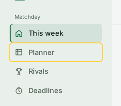
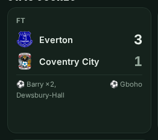
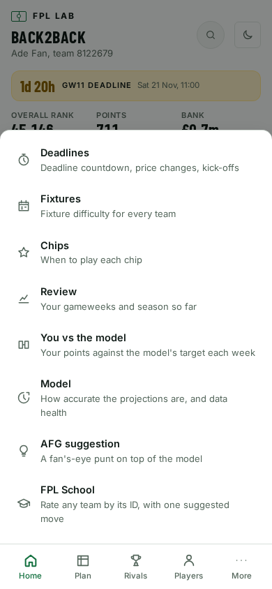
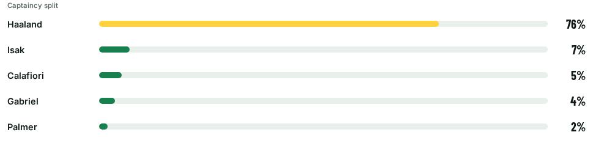
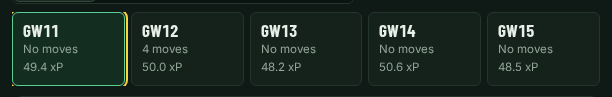
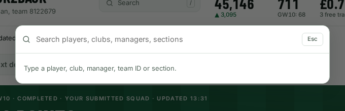
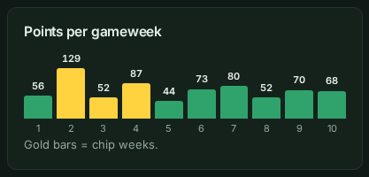
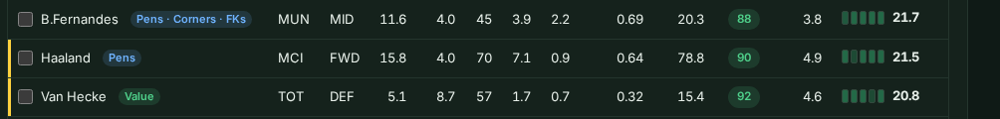

# FL-198: Accessibility follow-up (all 15 screens)

Read-only accessibility audit of all 15 screens (`week` + Current GW, `planner`, `rivals`, `deadlines`, `afg`, `players`, `stats`, `xptable`, `fixtures`, `school`, `chips`, `review`, `vsmodel`, `model`, `health`) covering keyboard focus order and visible focus rings, colour-only signalling in heat maps and tables, and light mode across every screen.

No site code was changed in this PR.

## What passed

- **Text contrast & size in both themes (`scripts/contrast_check.py --all`):** **41,908 text elements** measured across all 15 screens at 390 px and 1280 px in both dark and light mode — **0 colour pairs below WCAG AA** and **0 text sizes under 11 px**.
- **Tab order (`tabIndex > 0`):** 0 positive `tabindex` values found across all 15 screens; DOM tab order follows visual reading order on desktop.
- **Main heat maps (Fixtures & xP table):**
  - Fixtures FDR chips always print the difficulty number (`1`–`5`) and home/away casing alongside colour.
  - Fixtures Win chance / Attack / Clean sheet modes always print the percentage or projected goals alongside colour.
  - The xP table heat scale (`h0`–`h5`) always prints the numeric xP value and uses a diagonal hatch + italic header (not opacity alone) for weeks outside the horizon.

## Issues found

| # | Screen(s) | What's wrong | Severity | Screenshot | Suggested fix |
| --- | --- | --- | --- | --- | --- |
| 1 | **All 15 screens (Light mode)** | Global `:focus-visible` and component focus rings use `var(--hi)` (`#ffd23f`), which has only **1.46:1** contrast on light mode's `--surface` (`#fff`) and **1.32:1** on `--sunk` (`#e9efeb`), failing WCAG 2.1 SC 1.4.11 Non-text Contrast (3:1 minimum). | **High** |  | Introduce a `--focus` token (or use `var(--hi-text)` `#856000` at 5.7:1 in light mode, keeping `#ffd23f` in dark mode) for all `:focus-visible` outlines. |
| 2 | **Home (Current GW)** | `.mc-club` (`components.css:703`) and `.mc-p` (`components.css:716`) apply `all: unset` without a `:focus-visible` rule, so keyboard focus on club names and player pills in match cards has **no visible focus ring** (`outline-style: none`). | **High** |  | Add `.mc-club:focus-visible, .mc-p:focus-visible { outline: 2px solid var(--focus); outline-offset: 2px; border-radius: 4px; }` (matching `.linkish:focus-visible`). |
| 3 | **All screens on phones (More sheet, Light mode)** | `.sheetbody button` (`layout.css:178–182`) uses `all: unset` and only changes `background: var(--raised)` on `:focus-visible`. In light mode `--raised` (`#fff`) equals `--surface` (`#fff`), making keyboard focus **completely invisible**. | **High** |  | Add `outline: 2px solid var(--focus); outline-offset: -2px;` to `.sheetbody button:focus-visible` and use `var(--sunk)` for the light-mode focus fill. |
| 4 | **All 15 screens (Light mode — yellow chart/bar fills)** | Non-text bars/dots using `var(--hi)` (`#ffd23f`) on light surfaces fall below WCAG 1.4.11's 3:1 graphic contrast minimum: Rivals `.cb.top .fill` (1.32:1 on `--sunk` track), player modal `.ptsbars i.haul` (1.46:1 on `#fff`), and shot map `.sm-g`. | **Medium** |  | Use `var(--hi-text)` (or `--good` / `--accent` per FL-210) for filled bars and chart marks in light mode so graphic contrast exceeds 3:1. |
| 5 | **Home (Next deadline)** | `.hp-gw:focus-visible` (`views.css:540`) draws `outline-offset: 1px` outside the card inside `.hp-gws` (`overflow-x: auto`), so the top, bottom and leading edges of the focus ring are clipped by the scroll container. | **Medium** |  | Use an inset ring (`outline-offset: -3px`, matching `.pvcard:focus-visible` from FL-208) or add `padding: 3px` to `.hp-gws`. |
| 6 | **Search modal (All screens)** | `.search-box input` (`components.css:457`) sets `outline: none` without adding a `:focus-within` border/ring on `.search-box`, so keyboard users have no focus ring on the search field. | **Medium** |  | Add `.search-box:focus-within { outline: 2px solid var(--focus); outline-offset: 2px; }` so the whole search bar shows focus cleanly. |
| 7 | **Review ("Points per gameweek")** | Chip weeks in `.gwbars` are signalled **by colour alone** ("Gold bars = chip weeks", `review.js:89–90`). No chip abbreviation (`WC`, `BB`, `FH`, `TC`) is printed on the bar, and the `title` tooltip does not mention the chip played. | **Medium** |  | Print the 2-letter chip code (`WC`/`BB`/`FH`/`TC`) above or inside chip-week bars and include the chip name in the bar's `title` / `aria-label`. |
| 8 | **Players, Fixtures, xP table, Stats** | Owned players (`tr.mine`, `.gabars li.mine`) are marked **by colour alone** (a 3 px yellow left edge), with no visible text badge or screen-reader label (unlike Rivals, which includes a `You` pill). | **Medium** |  | Add a small `Yours` / `Own` badge or `aria-label` suffix on owned rows (and a subtle dot/icon alongside the border) so colour-blind and screen-reader users get the same signal. |
| 9 | **Player modal (Shot map)** | Shot outcomes (`Goal`, `Saved or post`, `Missed or blocked`) all use circles (`shotmap.js:19`), relying primarily on colour (yellow vs green vs grey) to distinguish them unless the user hovers each dot. | **Low** | *(See `hi/05-shotmap-goal.png` in FL-210)* | Differentiate shapes or strokes (e.g. filled diamond/star for goals, solid circle for saved, hollow ring for missed) and mirror those shapes in the legend. |
| 10 | **Rivals (Standings table)** | `td.lg-best` (`views.css:259`) marks the week's top GW score using yellow text colour alone, with no symbol or screen-reader note. | **Low** | *(See `hi/09-lg-best.png` in FL-210)* | Add a `title="Top GW score"` / `aria-label` or subtle underline/marker alongside the colour (or pair with FL-210's move to `--good`). |
| 11 | **Header & Status bar (All screens)** | `.dlpill .deadline` and `.st-when` (`nav.js:28, 49, 56–57`) use `
` / `` with `Enter`-only keydown handlers rather than native `<button>` elements. | **Low** | — | Convert both to native `<button type="button">` elements (or also handle `Space` if kept as custom buttons) for standard keyboard & screen-reader semantics. |
| 12 | **Home (Current GW match strip)** | `.gwscores:focus { outline: none; }` (`views.css:641`) suppresses the focus ring if the scrollable match strip itself receives keyboard focus. | **Low** | — | Replace with `.gwscores:focus-visible { outline: 2px solid var(--focus); outline-offset: 2px; }`. |
