# FL-210: Proposal for the remaining armband-yellow (`--hi`) uses

`site/styles/tokens.css` reserves armband yellow (`--hi` / `--hi-text` / `--hi-soft`) for **the captain, the deadline, and the thing you've selected**. After FL-192 (PR #228) moved AFG's numbered steps and Review's haul scores off `--hi`, **15 other uses** remain outside captain badges, deadlines, keyboard focus rings and `.sel` selection outlines.

No CSS was changed in this PR. Each row below shows the current usage, a cropped screenshot from the live site (19 Nov data, dark theme), and a recommendation.

## Summary

- **Keep (7):** genuinely represent user selections (your owned players, starred shortlist, pinned rival) or captaincy (league captaincy split leader).
- **Move to an existing token (7):** model metrics, chart series, goals, haul bars, DGW tags and 1st-place ranks — all have a better-fitting token already in `tokens.css`.
- **Needs Ade's decision (1):** Home's "Preview only" banner (`.hp-note`).

## Full audit (15 uses)

| # | File & line | Selector | What it marks | Crop | Proposal | Reasoning |
| --- | --- | --- | --- | --- | --- | --- |
| 1 | `site/styles/components.css:24` | `.stat dd.accent` | Projected xP figure in Players side panel and player modal | 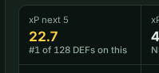 | **move to `--accent-text`** | xP is a model metric, not captain, deadline or selection; pitch green matches the rest of the projection UI. |
| 2 | `site/styles/components.css:208`, `site/styles/views.css:107` | `tr.mine td:first-child`, `tr.mine td.sticky-col` | 3 px left edge on rows for players/teams in your squad (Players, Fixtures, xP table) | 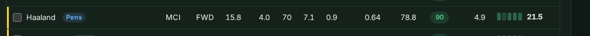 | **keep** | Marks your own selected squad consistently across every table in the app. |
| 3 | `site/styles/components.css:243` | `.cb.top .fill` | Leading bar in Rivals' "Captaincy split" chart | 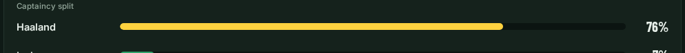 | **keep** | Highlights the league's top captain pick, which is directly a captaincy signal. |
| 4 | `site/styles/components.css:375` | `.s2` | Second line-chart series and legend swatch (e.g. "Live" on Model accuracy) | 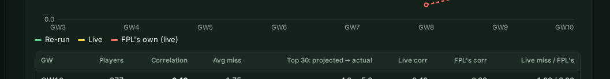 | **move to `--info`** | A data series only needs contrast against `--accent` (`s1`); `--info` blue separates the lines without implying captain or deadline. |
| 5 | `site/styles/components.css:645, 649` | `.sm-g`, `.sm-key.sm-g` | Goal dots and legend swatch on the Understat shot map | 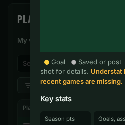 | **move to `--good`** | Goals are a positive match outcome (like haul scores moved in FL-192) and read clearly against saved/missed shots. |
| 6 | `site/styles/components.css:704` | `.mcard.mine` | 3 px left edge on Current GW match cards containing your players | 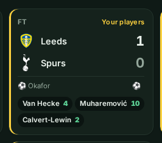 | **keep** | Same owned-squad selection marker as `tr.mine` in tables. |
| 7 | `site/styles/components.css:710` | `.mc-tag` | Player count label (e.g. `2 yours`) on Current GW match cards | 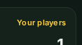 | **keep** | Directly pairs with `.mcard.mine`'s yellow edge to explain why that fixture is marked as yours. |
| 8 | `site/styles/views.css:58` | `.ptsbars i.haul` | 10+ point haul bars in the player modal's recent points chart | 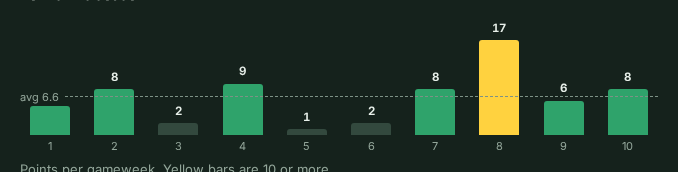 | **move to `--good`** | Matches FL-192's move of Review's haul pitch cards to `--good`, keeping yellow off high-score indicators. |
| 9 | `site/styles/views.css:259` | `td.lg-best` | Highest GW score cell in the Rivals mini-league table | 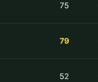 | **move to `--good`** | Marks a top score rather than a captain, deadline or selection; `--good` avoids competing with pinned-rival and "You" markers. |
| 10 | `site/styles/views.css:364` | `.xptable .xstar[aria-pressed="true"]` | Active star icon on shortlisted players in the xP table | 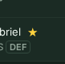 | **keep** | Explicitly a user-toggled selection (starred shortlist), and gold stars are universally understood. |
| 11 | `site/styles/views.css:369` | `.xptable .xdgw` | `DGW` double-gameweek tag inside xP table cells *(no DGW in GW11–16; representative cell shown)* | 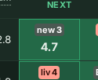 | **move to `--info`** | Schedule flag rather than captain/deadline/selection; `--info` stands out cleanly against the green xP heat scale. |
| 12 | `site/styles/views.css:442` | `.gabars li.mine` | 3 px left edge on your owned players in Stats' Goals & assists bars | 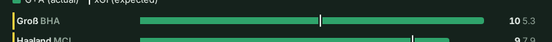 | **keep** | Matches `tr.mine` and `.mcard.mine` as the consistent "your squad" marker. |
| 13 | `site/styles/views.css:456` | `.ld-rank.first` | Rank `1` number in Stats' Points leaders list | 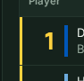 | **move to `--gold-fg`** | `tokens.css` already defines `--gold-fg` specifically for 1st-place honours, keeping armband yellow off leaderboard ranks. |
| 14 | `site/styles/views.css:543` | `.hp-note` | Soft yellow background on Home's "Preview only" banner | 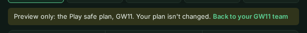 | **needs Ade's decision** | Signals a temporary preview state (not your real plan); could stay `--hi-soft` (selected preview), or move to a soft `--info` / `--warn` tint depending on whether it should feel informational or cautionary. |
| 15 | `site/styles/views.css:1282` | `.rv-table tr.is-rival td` | Soft yellow row highlight for your pinned rival in Rivals | 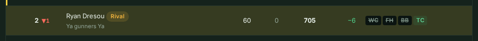 | **keep** | Marks the specific rival manager you explicitly pinned — a direct user selection. |
